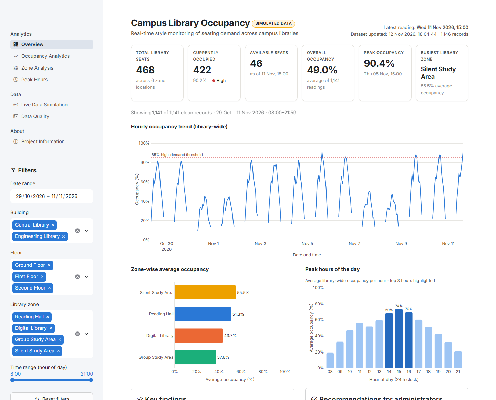

# Campus Library Occupancy Monitoring Dashboard

> **VII Semester B.Tech · Data Science and Visualization · Flipped-classroom assignment**
>
> ⚠️ **All data in this project is SIMULATED.** It is generated by `generate_data.py` and is not
> collected from real campus sensors, real libraries or real students.

**Live demo:** https://libraryoccupancydashboard.vercel.app  
(Deployed on Vercel as a container from `Dockerfile.vercel`. Records added on the live site are temporary: they are lost when the server sleeps after a few idle minutes.)



---

## 1. Introduction

An interactive analytics dashboard that monitors seat occupancy in campus libraries. It turns
hourly seat-count readings into KPIs, trends, zone comparisons, peak-hour analysis and
automatically generated recommendations. New readings can be added while the dashboard is
running, which updates every KPI and chart (simulated real-time monitoring).

## 2. Problem statement

Students often walk to a library zone that is already full while other zones have free seats.
Library administrators lack data about **when** and **where** demand peaks, so staffing,
seating layout and opening hours are planned by guesswork. The college needs a simple tool
that shows current seat availability and historical demand patterns.

## 3. Objectives

1. Monitor current occupancy and available seats across all library zones.
2. Identify peak hours and the busiest days of the week.
3. Compare seating demand across zones to support re-allocation of seats.
4. Demonstrate simulated real-time updates (new records → recalculated dashboard).
5. Ensure data quality: detect and handle missing, duplicate and invalid records.
6. Generate data-driven findings and actionable recommendations.

## 4. Intended users

| User | How they use the dashboard |
|---|---|
| Library administrators | Daily monitoring, staffing, opening-hour decisions |
| College management | Capacity planning and budgeting for furniture / space |
| Students | Checking where free seats are available |
| Campus facility managers | Scheduling cleaning, maintenance and energy use in quiet hours |

## 5. Technology stack

| Layer | Technology |
|---|---|
| Language | Python 3.10+ |
| Dashboard UI | Streamlit (multi-page navigation, sidebar filters, forms) |
| Data processing | Pandas, NumPy |
| Visualisation | Plotly (interactive charts with tooltips, zoom, export) |
| Storage | CSV file (`data/library_occupancy.csv`) |
| Testing | pytest + Streamlit `AppTest` (headless app testing) |

No paid APIs, databases or internet connection are needed (the Inter web font loads from Google
Fonts when online; otherwise a system font is used).

## 6. Project structure

```
library_occupancy_dashboard/
├── app.py                    # Streamlit dashboard (UI, charts, pages)
├── library_core.py           # Data logic: cleaning, KPIs, aggregations, insights, CSV append
├── generate_data.py          # Generates the SIMULATED dataset
├── data/
│   └── library_occupancy.csv # Dataset (1,146 rows: 1,140 readings + 6 deliberately flawed rows)
├── tests/
│   └── test_dashboard.py     # 23 automated tests
├── screenshots/              # Dashboard screenshots (light, dark and mobile)
├── .streamlit/config.toml    # Light + dark theme, font
├── requirements.txt
├── README.md
└── presentation_notes.md     # Three-member presentation script
```

## 7. Dataset description

`data/library_occupancy.csv` — **SIMULATED** hourly readings.

* **2 buildings, 6 zone locations, 468 seats:**

  | Building | Floor | Zone | Seats |
  |---|---|---|---|
  | Central Library | Ground Floor | Reading Hall | 150 |
  | Central Library | First Floor | Digital Library | 60 |
  | Central Library | Second Floor | Silent Study Area | 80 |
  | Engineering Library | Ground Floor | Group Study Area | 48 |
  | Engineering Library | First Floor | Reading Hall | 90 |
  | Engineering Library | First Floor | Digital Library | 40 |

* **Period:** 29 Oct 2026 – 11 Nov 2026 (14 days), one reading per location per hour from
  08:00 to 21:00. The final day stops at 15:00 to represent "today, so far".
* **Realistic behaviour modelled:** morning ramp-up, afternoon peak (14:00–16:00), evening
  decline; weekends at ~55% of weekday demand; a 10% rise in the second (exam-preparation)
  week; zone-specific demand; random noise. Occupied seats are capped at capacity.
* **Deliberately flawed rows (6):** one duplicate, one missing occupancy reading, one invalid
  timestamp (`2026-13-45 25:00:00`), one reading above capacity, one negative reading, one
  missing `Total_Seats`. These exist to prove the data-quality module works.

| Column | Type | Description |
|---|---|---|
| Timestamp | datetime `YYYY-MM-DD HH:MM:SS` | Time of the reading |
| Building | text | Library building |
| Floor | text | Floor within the building |
| Library_Zone | text | Reading Hall, Digital Library, Group Study Area, Silent Study Area |
| Total_Seats | integer | Seat capacity of the zone location |
| Occupied_Seats | integer | Seats in use at the time of reading |
| Available_Seats | integer | `Total_Seats − Occupied_Seats` |
| Occupancy_Percentage | float | `Occupied_Seats ÷ Total_Seats × 100` |
| Day | text | Day of week, derived from Timestamp |
| Hour | integer | Hour of day (0–23), derived from Timestamp |
| Data_Source | text | Always `SIMULATED` |

Regenerate the original dataset at any time with `python generate_data.py` (fixed random seed,
so the result is identical every time).

## 8. KPI definitions

All KPIs are recalculated from the **cleaned and filtered** data on every interaction.

| KPI | Definition |
|---|---|
| **Total Library Seats** | Sum of the seat capacity of every selected zone location |
| **Currently Occupied Seats** | Sum of occupied seats in the **latest reading of each location** |
| **Available Seats** | Total Library Seats − Currently Occupied Seats |
| **Overall Occupancy %** | Σ occupied seats ÷ Σ total seats across all readings in the selected period (seat-weighted average, so a 150-seat hall counts more than a 40-seat room) |
| **Peak Occupancy** | The highest library-wide occupancy % in any single clock hour, shown with its date and time |
| **Busiest Library Zone** | The zone with the highest seat-weighted average occupancy % |

The "Currently Occupied" card also shows a status label: **Normal** (< 60%), **Busy**
(60–85%), **High** (≥ 85%) — colour plus text, so it is not colour-only.

## 9. Visualisations

| Chart | Page | Why this chart |
|---|---|---|
| **A. Occupancy trend** (line, hourly/daily toggle, optional split by zone, 85% threshold line) | Overview, Occupancy Analytics | Lines are the standard way to show change over time; the toggle supports both detailed hourly and summarised daily analysis. Closed hours appear as gaps rather than misleading lines. |
| **B. Zone-wise occupancy** (horizontal bar, sorted) | Overview, Zone Analysis | Bars compare magnitudes accurately; sorting makes the ranking obvious. |
| **C. Peak hours** (bar per hour, top-3 highlighted) + **day × hour heatmap** | Overview, Peak Hours | Shows the busiest hours at a glance; the heatmap adds the weekday/weekend dimension. |
| **D. Occupied vs available seats** (stacked bar; current snapshot or period average) | Zone Analysis | Each bar's full height = capacity, so both usage and spare seats are visible together. |
| **E. Occupancy distribution** (donut) | Zone Analysis | Part-to-whole: each zone's share of all seat-hours used (only 4 slices, so a donut stays readable). |
| **F. Relationship analysis** (scatter: hour of day vs occupancy, coloured weekday/weekend, with hourly-mean line and Pearson r) | Occupancy Analytics | Shows the relationship and its spread. Pearson r is ~0 because the relationship is curved (rise then fall) — a useful talking point about the limits of linear correlation. |

Every chart has a title, labelled axes with units (%, seats, hour of day), a consistent
zone-colour mapping (Reading Hall = blue, Digital Library = orange, Group Study = green,
Silent Study = yellow on every chart), a colour-blind-checked palette and hover tooltips.

## 10. Filters

Sidebar filters: **date range, building, floor, library zone, time range (hour of day)** and
a **Reset filters** button. Every KPI card, chart, table and generated insight on the analytics
pages is recalculated from the filtered data. If a selection matches no records, a warning
is shown instead of empty charts.

## 11. Data-cleaning methodology

Cleaning runs every time the CSV is loaded (`library_core.clean`). The raw CSV is never
modified; every problem is listed on the **Data Quality** page with its CSV line number.

1. **Timestamp validation** — strict parse of `YYYY-MM-DD HH:MM:SS`; missing/impossible → excluded.
2. **Location validation** — Building/Floor/Zone must exist in the known layout → otherwise excluded.
3. **Missing `Total_Seats`** → repaired from the seating layout (capacity is fixed metadata).
4. **Missing `Occupied_Seats`** → excluded. A reading is never invented, because imputing it
   would distort the KPIs.
5. **Negative readings or `Occupied_Seats > Total_Seats`** → excluded and reported.
6. **Duplicates** (same timestamp + location) → first kept, later copies excluded.
7. **Derived fields** (`Available_Seats`, `Occupancy_Percentage`, `Day`, `Hour`) → always
   recomputed from source columns; disagreements are reported.

Result for the original dataset: 1,146 raw rows → 5 excluded, 1 repaired → **1,141 clean records**.

## 12. How simulated real-time updates work

The **Live Data Simulation** page imitates a sensor feed. It is clearly labelled as simulated
and is **not** connected to real sensors.

* **Manual record:** choose a zone, enter occupied seats, a date and a time, press *Submit
  record*. The record is validated (occupancy within 0…capacity, within opening hours
  08:00–21:59, not a duplicate). Invalid records are rejected with an explanation and are
  **not** written.
* **Add random record:** generates 1–10 realistic readings for the next hourly slots, using the
  same time-of-day / weekday / zone demand model as the dataset.
* **What happens after a save:**
  1. the row is appended to `data/library_occupancy.csv` (the file really changes),
  2. the data cache is keyed on the CSV's modification time and size, so the dashboard
     reloads the updated file,
  3. the date-range filter extends to include the new record,
  4. KPIs, charts and insights are recalculated,
  5. the page shows a success message, the latest record, before/after KPI deltas, the
     updated "latest reading" timestamp and the last 10 rows of the CSV.
* **Restore original dataset** (with a confirmation checkbox) regenerates the original CSV.

## 13. Installation

Requires Python 3.10 or newer.

```bash
cd library_occupancy_dashboard
python -m venv .venv
# Windows:            .venv\Scripts\activate
# macOS / Linux:      source .venv/bin/activate
pip install -r requirements.txt
```

## 14. Running the dashboard

```bash
streamlit run app.py
```

The dashboard opens at <http://localhost:8501>. Switch light/dark theme from the **⋮ menu →
Settings**. (If the CSV is missing it is regenerated automatically.)

Run the automated tests (they back up and restore the CSV, so your data is untouched):

```bash
pip install pytest
python -m pytest -v
```

## 15. Testing performed

23 automated tests (`tests/test_dashboard.py`) cover: dataset columns and ≥ 100 records;
internal consistency of derived fields; detection of every injected data issue; missing-value,
duplicate, invalid-timestamp and invalid-reading handling; KPI values against an independent
manual calculation; KPI cards matching the computed values; every filter and the reset button;
empty-filter warning; adding a manual record (CSV line count increases, KPIs change, trend
chart ends at the new record); rejection of invalid / duplicate / out-of-hours records (CSV
unchanged); random records; dataset restore; data-driven insights; every page rendering
without errors; and presence of all deliverables. The running app was also checked in a real
browser in light, dark and mobile layouts.

## 16. Limitations

* **Simulated data** — patterns are realistic but designed; real data would be noisier
  (sensor faults, holidays, events, weather).
* **Short period** — 14 days cannot show semester-level seasonality.
* **Not truly real-time** — updates happen when a record is added or the page is
  refreshed; there is no streaming connection to sensors.
* **CSV storage** — fine for a demo, but not safe for many users writing at the same time.
* **No authentication** — anyone with access can add records.
* **"Current" occupancy** uses the latest reading per location, which may be from different
  times if one zone's sensor is delayed.
* **Insights are rule-based** (thresholds such as 80% and 35%), not predictive.

## 17. Future improvements

* Connect to real IoT seat sensors / Wi-Fi counts / gate counters through an API.
* Store data in a database (PostgreSQL / SQLite) with concurrent writes.
* Auto-refresh streaming view and alert notifications (e-mail/SMS) when a zone exceeds 90%.
* Occupancy **forecasting** (e.g. Prophet, ARIMA, gradient boosting) to predict the next hours.
* Student-facing mobile view and seat booking.
* Login with role-based access (admin vs student).
* Add academic-calendar data (exams, holidays) to explain demand changes.
